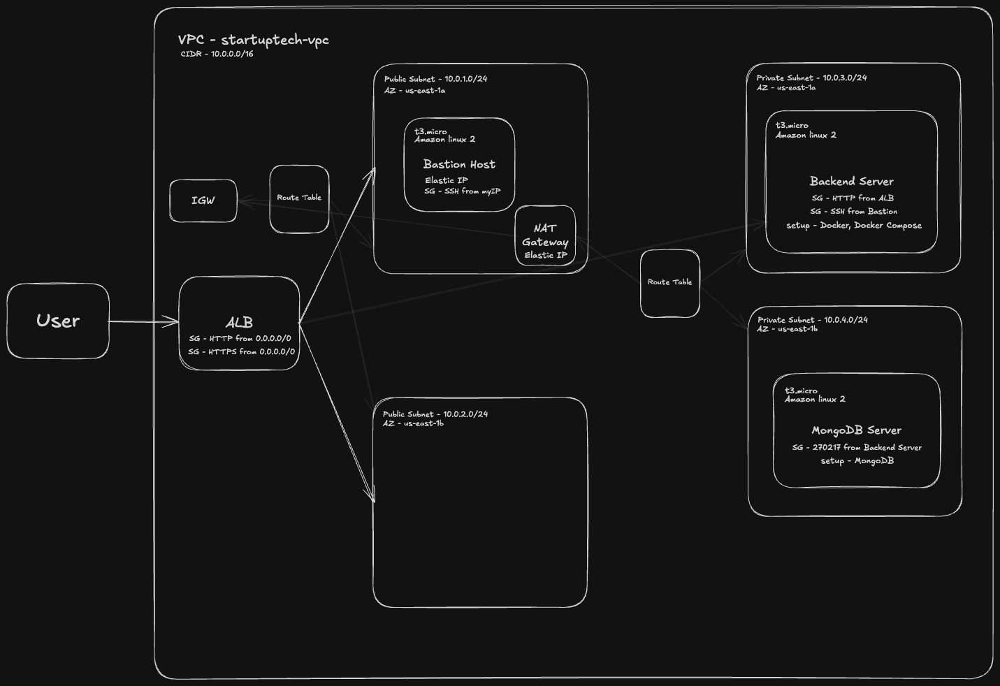

# MuchTodo Backend Deployment (AWS + Terraform + Docker)

This repository provisions AWS infrastructure for **StartupTech's MuchTodo** Golang backend with Terraform, containerizes the API with Docker, and runs it against MongoDB with Docker Compose on a private EC2 instance behind an Application Load Balancer.

- **Application source:** <https://github.com/Innocent9712/much-to-do/tree/feature/backend-only>
- **Backend code location in the source repo:** `much-to-do/Server/MuchToDo/`
- **API port:** `8080`  ·  **Health check:** `GET /health`

---

## Table of Contents

1. [Architecture](#architecture)
2. [Repository Structure](#repository-structure)
3. [Prerequisites](#prerequisites)
4. [Phase 1: Provision Infrastructure with Terraform](#phase-1-provision-infrastructure-with-terraform)
5. [Phase 2: Build and Push the Docker Image](#phase-2-build-and-push-the-docker-image)
6. [Phase 3: Deploy to the Backend EC2 Instance](#phase-3-deploy-to-the-backend-ec2-instance)
7. [Verification](#verification)
8. [Teardown / Cleanup](#teardown--cleanup)
9. [Troubleshooting](#troubleshooting)
10. [Evidence](#evidence)

---

## Architecture



### Resources created

| Area | Resources |
| --- | --- |
| Networking | VPC (`10.0.0.0/16`, DNS hostnames + support), 2 public subnets, 2 private subnets (across 2 AZs), Internet Gateway, NAT Gateway + Elastic IP, public and private route tables with associations |
| Security groups | **ALB**: 80/443 from anywhere · **Bastion**: 22 from your IP only · **Backend**: 8080 from ALB SG, 22 from Bastion SG · **MongoDB**: 27017 from Backend SG |
| Compute | Bastion (`t3.micro`, public subnet, Elastic IP), Backend (`t3.micro`, private subnet, installs Docker + Compose), MongoDB (`t3.micro`, private subnet, installs MongoDB). All use the latest Amazon Linux 2 AMI |
| Load balancing | Internet-facing ALB in the public subnets, target group on port 8080 with `/health` health check, HTTP listener on port 80 |

### Terraform outputs

| Output | Description |
| --- | --- |
| `vpc_id` | ID of the VPC |
| `alb_dns_name` | Public DNS name of the ALB |
| `bastion_public_ip` | Public IP of the Bastion host |
| `backend_private_ip` | Private IP of the Backend server |

---

## Repository Structure

```
backend-deployment-assessment/
├── terraform/
│   ├── main.tf                    # All AWS resource definitions
│   ├── variables.tf               # Input variables (with descriptions and defaults)
│   ├── outputs.tf                 # VPC ID, ALB DNS, Bastion IP, Backend private IP
│   ├── terraform.tfvars.example   # Example variable values (copy to terraform.tfvars)
│   └── user_data/
│       ├── backend_setup.sh       # Installs Docker, Docker Compose v2 and Git
│       └── mongodb_setup.sh       # Installs and starts MongoDB
├── Dockerfile                     # Multi-stage build for the Go API
├── docker-compose.yml             # backend + mongodb services
├── .dockerignore                  # Excludes .git, .env, docs from the build context
├── .env.example                   # Template for application environment variables
├── evidence/                      # Architecture diagram and deployment screenshots
└── README.md
```

---

## Prerequisites

### Tools

| Tool | Version | Check |
| --- | --- | --- |
| [Terraform](https://developer.hashicorp.com/terraform/install) | ≥ 1.5 | `terraform -version` |
| [AWS CLI](https://docs.aws.amazon.com/cli/latest/userguide/getting-started-install.html) | v2 | `aws --version` |
| [Docker](https://docs.docker.com/get-docker/) with Compose v2 | Docker ≥ 24 | `docker --version && docker compose version` |
| Git | any | `git --version` |
| SSH client | OpenSSH | `ssh -V` |

### Accounts

1. An AWS account and an IAM user with permissions for VPC, EC2, ELB and EIP.
2. A Docker Hub account with a private repository for the backend image.

---

## Phase 1: Provision Infrastructure with Terraform

### 1. Clone this repository

```bash
git clone https://github.com/codingwithIsioma/backend-deployment-assessment.git
```

```bash
cd backend-deployment-assessment/terraform
```

### 2. Configure variables

```bash
cp terraform.tfvars.example terraform.tfvars
```

Edit `terraform.tfvars` and set your values:

```hcl
aws_region    = "us-east-1"
project_name  = "startuptech"
environment   = "dev"
instance_type = "t3.micro"
vpc_cidr      = "10.0.0.0/16"
my_ip         = "<your-public-ip>/32"
key_pair_name = "<your-key-pair-name>"
```

| Variable | Description | Default |
| --- | --- | --- |
| `aws_region` | AWS region to deploy into | `us-east-1` |
| `instance_type` | EC2 instance type for all servers | `t3.micro` |
| `project_name` | Prefix for resource names and tags | `startuptech` |
| `environment` | `dev`, `staging` or `prod` | `dev` |
| `vpc_cidr` | VPC CIDR block | `10.0.0.0/16` |
| `public_subnet_cidr_block` | CIDRs for the two public subnets | `["10.0.1.0/24", "10.0.2.0/24"]` |
| `private_subnet_cidr_block` | CIDRs for the two private subnets | `["10.0.3.0/24", "10.0.4.0/24"]` |
| `my_ip` | Your IP in CIDR form, allowed to SSH into the Bastion | *(required)* |
| `key_pair_name` | Existing EC2 key pair name for SSH | `""` |

`terraform.tfvars` is listed in `.gitignore` and is never committed.

### 3. Initialize, plan and apply

```bash
terraform init
```

```bash
terraform fmt && terraform validate
```

```bash
terraform plan 
```

```bash
terraform apply 
```

Terraform finishes with `Apply complete! Resources: 36 added, 0 changed, 0 destroyed.` followed by the outputs.

### 4. View the outputs

```bash
terraform output
```

Note the `bastion_public_ip`, `backend_private_ip` and `alb_dns_name` values; they are used in the steps below.

---

## Phase 2: Build and Push the Docker Image

### Why the image is built locally

The Go build is too slow on a `t3.micro` instance (1 GB RAM, burstable CPU), so building the image on the Backend EC2 server takes far too long. Instead, the image is **built locally, pushed to my private Docker Hub repository, and pulled down on the Backend EC2 instance**. This was the fastest way to get the application running on the server.

### 1. Get the application source and add the Docker files

From the root of this repository (one level above `terraform/`):

```bash
git clone -b feature/backend-only https://github.com/Innocent9712/much-to-do.git
```

The backend code lives in `much-to-do/Server/MuchToDo/`, so the Docker files from this repository go into that folder:

```bash
cp Dockerfile docker-compose.yml .dockerignore .env.example much-to-do/Server/MuchToDo/
```

```bash
cd much-to-do/Server/MuchToDo
```

### 2. Create the environment file

```bash
cp .env.example .env
```

Edit `.env` and change at least `MONGO_ROOT_PASSWORD` and `JWT_SECRET_KEY`. Docker Compose builds `MONGO_URI` from `MONGO_ROOT_USERNAME` and `MONGO_ROOT_PASSWORD`, pointing at the `mongodb` service.

| Variable | Purpose |
| --- | --- |
| `PORT` | Port the API listens on (`8080`) |
| `MONGO_ROOT_USERNAME` / `MONGO_ROOT_PASSWORD` | MongoDB root credentials (used by both containers) |
| `DB_NAME` | Application database name |
| `JWT_SECRET_KEY` / `JWT_EXPIRATION_HOURS` | Auth token signing |
| `LOG_LEVEL` / `LOG_FORMAT` | Logging configuration |

### 3. Build the images

I build locally on macOS (Apple Silicon), where Docker builds `arm64` images by default. The Backend EC2 instance (`t3.micro`) runs on `x86_64`, so it needs a `linux/amd64` image, but that image can't be used to run the app locally on my Mac. So I build **two images** and push both to Docker Hub:

| Tag | Platform | Used on |
| --- | --- | --- |
| `codewithisioma/muchtodo:v1` | `linux/amd64` | Backend EC2 instance |
| `codewithisioma/muchtodo:v1-arm64` | `linux/arm64` | Local macOS machine |

Build the `linux/amd64` image for the EC2 instance:

```bash
docker build --platform linux/amd64 -t codewithisioma/muchtodo:v1 .
```

Build the `linux/arm64` image for running locally:

```bash
docker build --platform linux/arm64 -t codewithisioma/muchtodo:v1-arm64 .
```

Confirm the architecture of each image:

```bash
docker image inspect codewithisioma/muchtodo:v1 --format '{{.Os}}/{{.Architecture}}'
```

```bash
docker image inspect codewithisioma/muchtodo:v1-arm64 --format '{{.Os}}/{{.Architecture}}'
```

The Dockerfile:

- **Stage 1 (`golang:1.25-alpine`)** downloads modules and compiles a static binary (`CGO_ENABLED=0`).
- **Stage 2 (`alpine:3.20`)** copies only the binary and a `.env` template, runs as non-root `appuser`, exposes `8080`, and defines a `HEALTHCHECK` on `/health`.

```bash
docker images codewithisioma/muchtodo
```

### 4. Push both images to Docker Hub

```bash
docker login
```

```bash
docker push codewithisioma/muchtodo:v1
```

```bash
docker push codewithisioma/muchtodo:v1-arm64
```

### 5. Run and test locally

The `docker-compose.yml` in this repository uses the `v1` tag (the `amd64` image for EC2). To run locally, change the backend `image` in your local copy (`much-to-do/Server/MuchToDo/docker-compose.yml`) to the `arm64` tag:

```yaml
services:
  backend:
    image: codewithisioma/muchtodo:v1-arm64
```

If the `arm64` image is not already on your machine, pull it when needed:

```bash
docker pull codewithisioma/muchtodo:v1-arm64
```

The application source already contains its own compose file next to ours, so always pass `-f docker-compose.yml` to select this one:

```bash
docker compose -f docker-compose.yml up -d
```

```bash
docker compose -f docker-compose.yml ps
```

Both `muchtodo-backend` and `mongodb-server` should be `running`, with MongoDB `healthy`. The backend waits for MongoDB's health check (`depends_on: condition: service_healthy`), both services use `restart: unless-stopped`, share the `app-network` bridge network, and MongoDB data persists in the `mongo_data` volume.

```bash
curl -i http://localhost:8080/health
```

Expect `HTTP/1.1 200 OK`. View logs if needed:

```bash
docker compose -f docker-compose.yml logs -f backend
```

Stop the local stack:

```bash
docker compose -f docker-compose.yml down -v
```

---

## Phase 3: Deploy to the Backend EC2 Instance

The backend server is in a private subnet, so it can only be reached through the Bastion host.

### 1. Log in

To log in to the Bastion host:

```bash
ssh -i ~/path/to/your-key.pem ec2-user@<bastion-host-public-ip>
```

To log in to the Backend server through the Bastion (local → Bastion → Backend):

My EC2 key pair is saved only on my local machine, not on the Bastion host. Instead of copying the private key onto the Bastion, I jump straight from local → Bastion → Backend in one command. `ProxyCommand` opens a tunnel through the Bastion (`-W %h:%p`), and both hops authenticate with the same local key.

```bash
ssh -i ~/path/to/your-key.pem -o ProxyCommand="ssh -i ~/path/to/your-key.pem -W %h:%p ec2-user@<bastion-host-public-ip>" ec2-user@<backend-private-ip>
```

### 2. Confirm the user data finished

On the Backend server:

```bash
docker --version && docker compose version && git --version
```

If a command is missing, check the bootstrap log:

```bash
sudo tail -n 50 /var/log/cloud-init-output.log
```

### 3. Clone the application and add the Docker files

```bash
git clone -b feature/backend-only https://github.com/Innocent9712/much-to-do.git
```

```bash
git clone https://github.com/<your-github-username>/backend-deployment-assessment.git
```

```bash
cp backend-deployment-assessment/{docker-compose.yml,.env.example} much-to-do/Server/MuchToDo/
```

```bash
cd much-to-do/Server/MuchToDo && cp .env.example .env
```

Edit `.env` with real secrets (`nano .env`), as in Phase 2.

### 4. Start the application

On EC2, the `docker-compose.yml` uses the `codewithisioma/muchtodo:v1` tag, so Docker Compose pulls the `linux/amd64` image from Docker Hub.

```bash
docker compose -f docker-compose.yml up -d
```

```bash
docker compose -f docker-compose.yml ps
```

```bash
curl -i http://localhost:8080/health
```

Within about a minute the ALB health check (`/health`, every 30s, 2 successes) marks the target as **healthy**.

---

## Verification

From your local machine:

```bash
curl -i http://<alb-dns-name>/health
```

Check target health from the CLI:

```bash
aws elbv2 describe-target-health --target-group-arn $(aws elbv2 describe-target-groups --names startuptech-dev-alb-target-group --query 'TargetGroups[0].TargetGroupArn' --output text)
```

The target state should be `healthy`, and the `curl` should return `200 OK` from the backend API.

---

## Teardown / Cleanup

### 1. Stop the containers (on the Backend server)

```bash
docker compose -f docker-compose.yml down -v
```

`-v` also removes the `mongo_data` volume. Omit it if you want to keep the data.

### 2. Destroy the AWS infrastructure (local machine)

```bash
cd terraform
```

```bash
terraform destroy
```

Type `yes` to confirm. Terraform removes every resource it created (ALB, instances, NAT Gateway, Elastic IPs, subnets, VPC…).

### 3. Optional cleanup

Remove local Docker images and volumes:

```bash
docker image rm codewithisioma/muchtodo:v1 codewithisioma/muchtodo:v1-arm64
```

```bash
docker volume prune
```

---

## Troubleshooting

| Symptom | Likely cause / fix |
| --- | --- |
| SSH to Bastion times out | Your IP changed. Update `my_ip` in `terraform.tfvars` and run `terraform apply` |
| `docker: command not found` on Backend | User data still running or failed: check `/var/log/cloud-init-output.log` |
| `permission denied` on Docker socket | Log out and back in (the `ec2-user` was added to the `docker` group), or use `sudo` |
| `pull access denied` for the image | Run `docker login` on the Backend server; the Docker Hub repository is private |
| ALB returns `502` / `503` | Containers not running or target unhealthy. Run `docker compose -f docker-compose.yml ps` and `curl localhost:8080/health` on the Backend |
| Backend container restarting | Check `docker compose -f docker-compose.yml logs backend`; usually wrong MongoDB credentials in `.env` |

---

## Security Notes

- Only the ALB is reachable from the internet; Backend and MongoDB live in private subnets.
- SSH is allowed only from your IP to the Bastion, and only from the Bastion to the Backend.
- MongoDB accepts connections only from the Backend security group.
- Containers run as a non-root user.
- The backend image is stored in a private Docker Hub repository.
- `terraform.tfvars` and `.env` are git-ignored; only the `.example` files are committed.
- The committed `terraform.tfstate` must contain no passwords or secret keys: no secrets are passed to Terraform as variables, so the state holds only resource metadata.

---

## Evidence

Screenshots are stored in [`evidence/`](evidence/):

| # | File | Shows |
| --- | --- | --- |
| 1 | `01-terraform-init.png` | `terraform init` succeeded and downloaded providers |
| 2 | `02-terraform-plan.png` | Full plan of resources to be created |
| 3 | `03-terraform-apply.png` | `Apply complete!` with resource count |
| 4 | `04-vpc-console.png` | VPC with correct CIDR and name tag |
| 5 | `05-subnets-console.png` | Four subnets across two AZs |
| 6 | `06-security-groups.png` | Security groups and inbound rules |
| 7 | `07-ec2-instances.png` | Bastion, Backend and MongoDB running |
| 8 | `08-alb-target-group.png` | ALB active, target group healthy |
| 9 | `09-docker-build.png` | Successful multi-stage `docker build` |
| 10 | `10-compose-local.png` | Both containers running locally |
| 11 | `11-health-local.png` | `200` from `localhost:8080/health` |
| 12 | `12-ssh-bastion.png` | SSH local → Bastion → Backend |
| 13 | `13-compose-ec2.png` | Both containers running on the Backend EC2 |
| 14 | `14-alb-access.png` | Backend response via the ALB DNS name |
